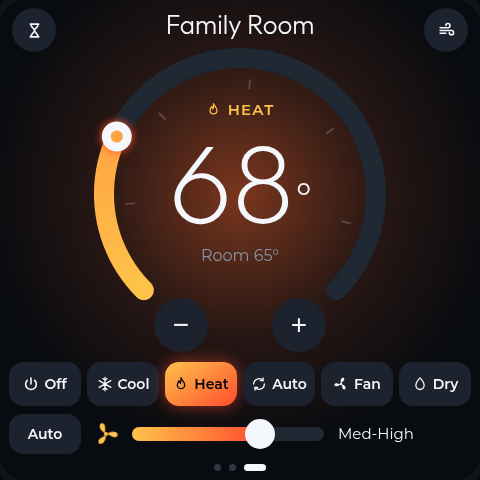
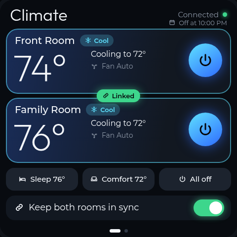
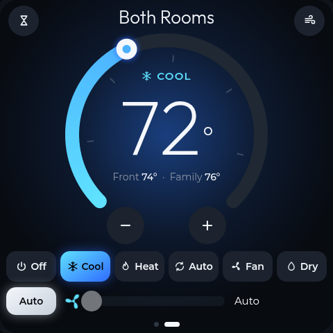
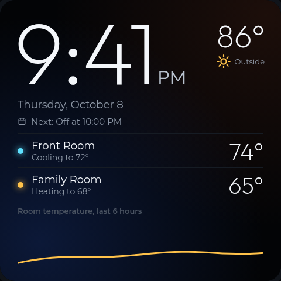
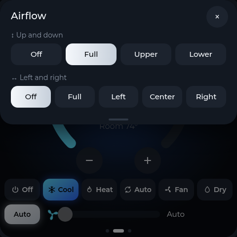
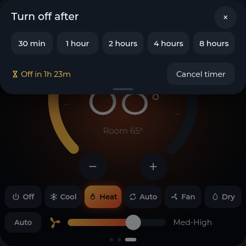
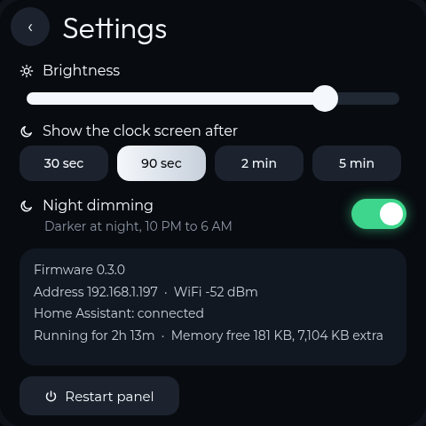
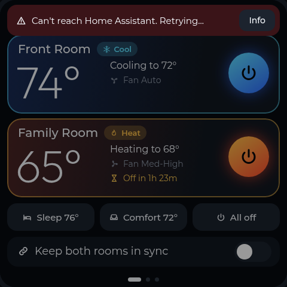
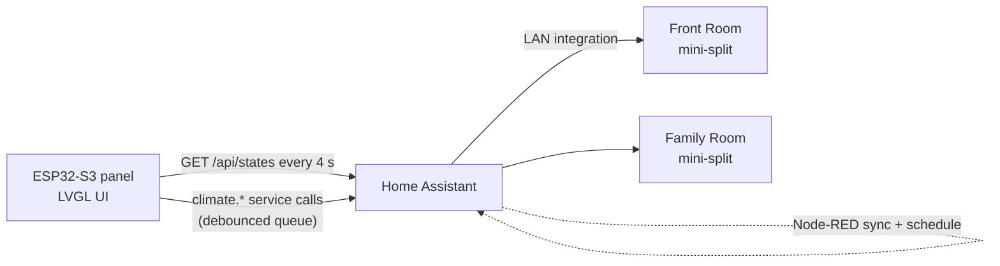

# AC Controller


A wall-mounted touchscreen for two ductless mini-split air conditioners. A 4-inch ESP32-S3
panel talks to Home Assistant and gives both rooms one fast, glanceable control surface.


## Why

Mini-split remotes are small, cryptic and easy to lose, and the phone apps take too many taps for
"make it a bit cooler". One wall panel shows both units at once, keeps them in sync
when you want one temperature everywhere, and is simple enough for anyone in the house to use
without explanation.

## Features

- **Overview page** with both rooms at a glance: room temperature, mode, setpoint, fan and any
  running off-timer, plus one-tap power per unit
- **Room pages** with a gradient setpoint dial (drag it or tap − / +), six modes (Off, Cool,
  Heat, Auto, Fan, Dry) and a fan-speed slider
- **Sync mode** keeps both rooms in lock-step, and the UI collapses to a single "Both Rooms" page
- **Presets** (Sleep 76°, Comfort 72°, All off), an **airflow** sheet for vertical and horizontal
  swing, and per-room **off timers** that survive a reboot
- **Ambient clock screen** after idle, with outdoor weather and a 6-hour room-temperature trend.
  The first touch only wakes the screen, so you can't change a setting by accident
- **Night dimming** from 10 PM to 6 AM, plus an **offline banner** that locks controls whenever
  Home Assistant can't be reached
- Optimistic UI with a "Saved" / "No response" pulse on every command
- **OTA updates** over HTTP (`POST /update`) with an ArduinoOTA fallback

## Screens

| | |
|:---:|:---:|
|  |  |
| **Room page**: heating, with an off timer running | **Sync on**: both units linked |
|  |  |
| **Both Rooms**: one dial for the whole house | **Ambient screen**: clock, weather and trend after idle |
|  |  |
| **Airflow**: vertical and horizontal swing | **Off timer**: 30 min to 8 h |
|  |  |
| **Settings**: brightness, clock delay, night dimming, diagnostics | **Offline**: controls lock until Home Assistant is back |

<sub>Screens rendered from the pixel-exact HTML mockups in <code>design/</code>, which track the firmware.</sub>

## How it works



- The panel polls each `climate.*` entity every 4 seconds and sends changes through a command
  queue. Mode is sent before temperature, then fan, with about 1.5 s of debounce, so quickly
  dragging the dial produces one call instead of twenty.
- Every field is **optimistically held** for 8 s after a tap, so the UI never snaps back while the
  unit catches up.
- Powering a unit on from Off sends `set_hvac_mode` first and the setpoint a second later. The
  integration accepts a combined call but silently ignores the power-on.

## Hardware

| Part | Notes |
|---|---|
| Guition / Sunton **ESP32-4848S040** | ESP32-S3, 16 MB flash, 8 MB PSRAM, 4" 480×480 ST7701 RGB panel |
| GT911 capacitive touch | I²C on GPIO 19 / 45 |
| Mini-splits | Any unit exposed to Home Assistant as a `climate.*` entity |

## Software stack

- PlatformIO + Arduino core (`espressif32@7.0.1`)
- [LVGL 9.2](https://lvgl.io) with partial rendering into two internal-RAM buffers,
  [Arduino_GFX](https://github.com/moononournation/Arduino_GFX), ArduinoJson 7
- Custom fonts (Outfit, Montserrat, Font Awesome) and pre-rendered dial assets, generated by
  `firmware/tools/gen_fonts.py` and `gen_assets.py`

## Repository layout

| Path | What it is |
|---|---|
| `firmware/` | The panel firmware (UI, Home Assistant client, OTA, settings) |
| `design/ac-panel-mockups.html` | Interactive, pixel-exact UI mockups; open it in a browser |
| `disptest/` | Minimal display + touch bring-up sketch |
| `probe/` | Board-identification sketch (chip info + I²C pin-pair scan) |

## Building

1. Copy `secrets.h.example` to `secrets.h` (repo root, gitignored) and fill in your Wi-Fi
   details, Home Assistant URL, a long-lived access token (use a dedicated, non-admin HA
   user) and an OTA password.
2. Set your two climate entity IDs in `AC_ENTITY` at the top of `firmware/src/ha.cpp`.
3. Build and flash:
   ```sh
   cd firmware
   pio run -e usb -t upload                        # first flash over USB
   AC_HOST=<panel-ip> pio run -e ota -t upload     # later updates over Wi-Fi
   ```

## Status

Firmware 0.3.x is running on the panel. Further UI refinements from the mockups are in progress.
