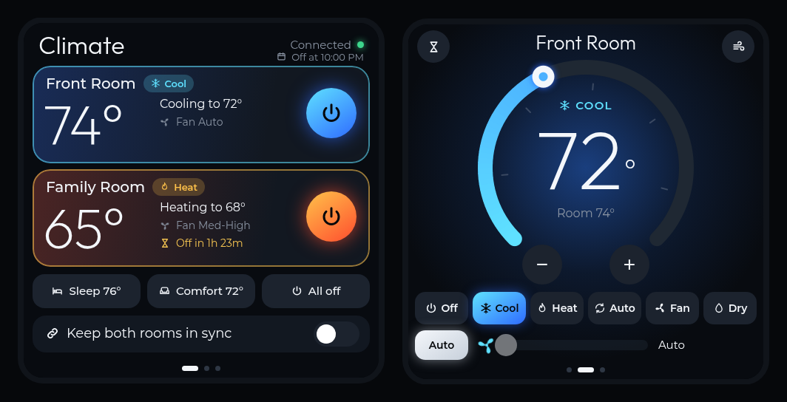

# AC Controller

A wall-mounted touchscreen for two ductless mini-split air conditioners, built on a
4-inch ESP32-S3 panel and driven by Home Assistant.



## Features

- **Overview page** with both rooms at a glance: room temperature, mode, setpoint, fan and
  any running off-timer, plus one-tap power per unit
- **Room pages** with a gradient setpoint dial (drag it or tap − / +), six modes (Off, Cool,
  Heat, Auto, Fan, Dry) and a fan-speed slider
- **Sync mode**: keep both rooms in lock-step, collapsing the UI to a single "Both Rooms" page
- **Presets** (Sleep, Comfort, All off), an airflow/swing sheet and per-room **off timers**
- **Ambient clock screen** after idle, with weather and a 6-hour trend; the first touch only
  wakes the screen, so you can't change settings by accident
- **Night dimming** (10 PM – 6 AM) and an offline banner that locks controls whenever Home
  Assistant can't be reached
- Optimistic UI with a "Saved" / "No response" confirmation for every command
- **OTA updates** over HTTP (`POST /update`) with an ArduinoOTA fallback

## Hardware

| Part | Notes |
|---|---|
| Guition / Sunton **ESP32-4848S040** | ESP32-S3, 16 MB flash, 8 MB PSRAM, 4" 480×480 ST7701 RGB panel |
| GT911 capacitive touch | I²C on GPIO 19 / 45 |
| Mini-splits | Any unit exposed to Home Assistant as a `climate.*` entity |

## Software stack

- PlatformIO + Arduino core (`espressif32@7.0.1`)
- [LVGL 9.2](https://lvgl.io), [Arduino_GFX](https://github.com/moononournation/Arduino_GFX), ArduinoJson 7
- Home Assistant REST API: polls `GET /api/states/<entity>` every 4 s and sends
  `climate.*` service calls through a debounced command queue
- Custom fonts (Outfit, Montserrat, Font Awesome) and pre-rendered dial assets generated by
  `firmware/tools/gen_fonts.py` and `gen_assets.py`

## Repository layout

| Path | What it is |
|---|---|
| `firmware/` | The panel firmware (UI, Home Assistant client, OTA, settings) |
| `design/ac-panel-mockups.html` | Interactive, pixel-exact UI mockups; open it in a browser |
| `disptest/` | Minimal display + touch bring-up sketch |
| `probe/` | Board-identification sketch (chip info + I²C pin-pair scan) |

## Building

1. Copy `secrets.h.example` to `secrets.h` (repo root, gitignored) and fill in your Wi-Fi
   details, Home Assistant URL, a long-lived access token (use a dedicated, non-admin HA
   user) and an OTA password.
2. Set your two climate entity IDs in `AC_ENTITY` at the top of `firmware/src/ha.cpp`.
3. Build and flash:
   ```sh
   cd firmware
   pio run -e usb -t upload     # first flash over USB
   AC_HOST=<panel-ip> pio run -e ota -t upload   # later updates over Wi-Fi
   ```

## Status

Firmware 0.3.x is running on the panel. Further UI refinements from the mockups are in progress.
